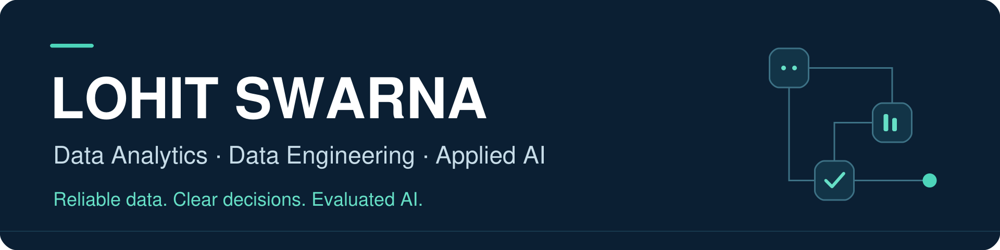

# Lohit Swarna

**Data Analytics · Data Engineering · Applied AI**

My portfolio focuses on turning source data into reconciled business metrics, dependable pipelines and useful, evaluated AI systems. I’m pursuing junior and associate opportunities where careful SQL, Python engineering and clear communication support better decisions.

[LinkedIn](https://www.linkedin.com/in/swarna-lohit/) · [Source code](https://github.com/datasci-lohitt/swarna-lohitt) · [Project registry](PROJECT_REGISTRY.md) · [Development roadmap](PORTFOLIO_ROADMAP.md)

## Start with the evidence

**[Governed Business Intelligence — validated data foundation](projects/governed-bi/README.md)**

A reproducible retail analytics foundation with explicit invoice-line grain, source lineage, data-quality decisions, repeatable ingestion and reconciled SQL measures. Explore the [executive analysis](projects/governed-bi/reports/EXECUTIVE_REPORT.md), [recorded run](projects/governed-bi/reports/run_manifest.json) and [tests](projects/governed-bi/tests).

**Executed evidence:** 27 passing tests · 50,000 historical rows accounted for · identical aggregate controls after replay. [Validation record](docs/VALIDATION.md).

The demonstration uses a bounded historical UCI retail source. It reports observed activity, not production adoption, audited accounting revenue or financial savings. Native Power BI delivery remains a separate milestone.

## Featured project portfolio

| Project | Business decision | Current evidence | Next milestone |
|---|---|---|---|
| **[Governed Business Intelligence Platform](projects/governed-bi/README.md)** | Which order and customer measures can a commercial team trust? | Tested data foundation; [executed analysis](projects/governed-bi/reports/EXECUTIVE_REPORT.md) | Native Power BI model, DAX validation and dashboard review |
| **[Data Pipeline Reliability & Monitoring](projects/pipeline-reliability/README.md)** | Can an analytics team recover from late files, revisions and failed loads? | Engineering design and acceptance contract; implementation pending | Atomic partition load and failure/recovery demonstration |
| **[Enterprise AI Knowledge Assistant](projects/knowledge-assistant/README.md)** | Can an operations answer be traced to an approved, current source? | Architecture and evaluation plan; implementation pending | Licensed corpus, retrieval baseline and held-out evaluation |

Each project states what is implemented, what was measured and what is still planned. Design documents are not presented as running demonstrations.

## Technical focus

| Domain | Evidence and direction |
|---|---|
| **Data analytics & BI** | SQL, dimensional modeling, KPI definitions, reconciliation and exception analysis. Power BI, Power Query and DAX are the next reporting layer. |
| **Data engineering** | Python ingestion, explicit source contracts, SQLite and replay-safe data handling in the BI foundation. PostgreSQL, dbt, Airflow and operational monitoring are scoped in the reliability design. |
| **Python development** | Modular command-line workflows, validation, precise metric calculations, logging/error handling and automated tests. See the implemented project's run instructions. |
| **ML & data science** | Temporal validation, simple baselines, calibration and explainability are requirements for the later customer-lifecycle and forecasting projects. Model results have not been published yet. |
| **Generative AI & NLP** | The knowledge-assistant design separates document processing, retrieval, grounded answers, citations, abstention and evaluation. A running RAG or fine-tuned model is not claimed. |
| **AI automation** | Human approval, retries, idempotency and audit trails are planned delivery controls; no unattended external-action system is presented as complete. |

## Career direction

- **Analytics & BI:** Data Analyst, BI / Power BI Analyst and Business Analyst–Data.
- **Data & analytics engineering:** Associate / Junior Data Engineer, Junior Analytics Engineer and Python Developer–Data.
- **Applied AI:** Junior AI/ML Engineer, Data Scientist, GenAI / NLP roles, AI Automation Engineer and AI Research Assistant.

The [career evidence map](docs/CAREER_MAP.md) tracks all fifteen target roles against delivered and planned artifacts.

## How I approach engineering

Define the business decision before choosing tools. Preserve source provenance and table grain. Reconcile measures instead of trusting a chart. Test failures and reruns. Compare models against simple baselines. Publish limitations alongside results.

See the [engineering standards](docs/ENGINEERING_STANDARDS.md) and [contribution guide](CONTRIBUTING.md) for the working contracts behind this portfolio.

## Connect

I’m interested in junior and associate data and AI opportunities, practical technical collaboration and feedback on the work published here.

**[Connect on LinkedIn](https://www.linkedin.com/in/swarna-lohit/)** · **[Explore the source](https://github.com/datasci-lohitt/swarna-lohitt)**
