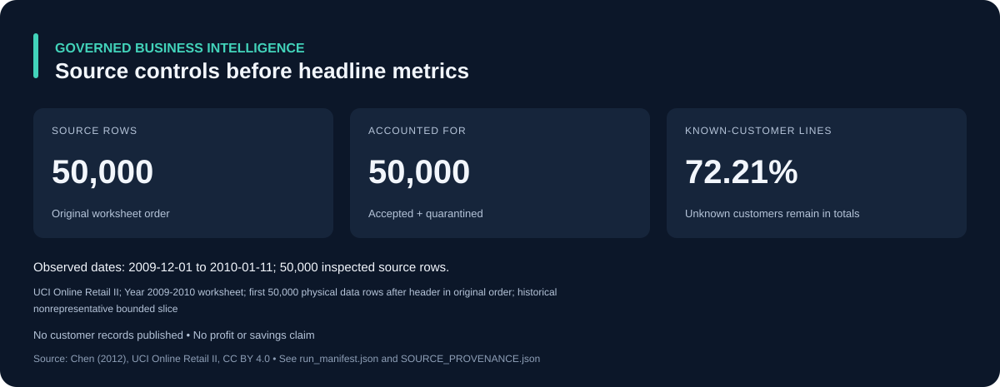
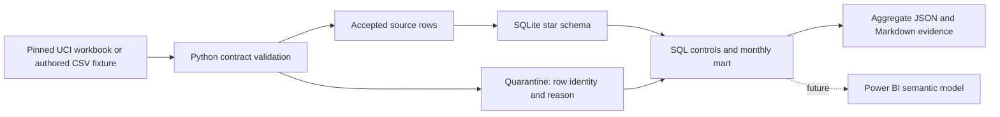

# Governed Business Intelligence Platform

**Status: validated data foundation.** A reproducible Python/SQL slice is implemented and measured. Native Power BI reporting, stakeholder UAT and production deployment remain future milestones.

This project answers a practical reporting question: **can an analyst reconcile every source row, preserve the distinction between cancellation activity and signed line value, and explain which customers are missing before publishing a KPI?** It supplies a local star schema, explicit metric contracts, quarantine reasons, transactional source replacement and an aggregate report.



[Read the measured report](reports/EXECUTIVE_REPORT.md) · [Inspect the run manifest](reports/run_manifest.json) · [Review validation](reports/VALIDATION.md)

## Business problem and objectives

Commercial and finance analysts need consistent source totals and a visible exception policy. Dashboard totals can become misleading when repeat line items are deduplicated incorrectly, anonymous customers disappear from revenue, or cancellation codes are treated as equivalent to negative quantities. The stakeholders here are a **proposed** finance analyst, commercial analyst and BI owner; no company deployment or stakeholder interview is claimed.

The current acceptance criteria are: account for every inspected source row; preserve signed four-decimal monetary values; retain missing-customer lines in all-line totals; avoid guessing a business key; reproduce controls on rerun; and retain the previous partition if rebuilding fails. Tests verify these requirements. Cost/margin, recognized accounting revenue, real retention, customer demographics and live executive reporting are outside this foundation.

## Architecture and stack



Python 3.12+ and SQLite implement the CSV path with no third-party dependency. The optional real-workbook reader uses pinned `openpyxl==3.1.5` and `et-xmlfile==2.0.0`. Money is represented as integer **1/10,000 GBP** units; no binary float aggregation is used. See the [metric/schema contract](docs/METRIC_CONTRACT.md) for grain, keys, transformations and deliberate limits.

## Data and provenance

**Attribution:** Chen, D. (2012). *Online Retail II* [Dataset]. UCI Machine Learning Repository. [DOI 10.24432/C5CG6D](https://doi.org/10.24432/C5CG6D). [Official dataset page](https://archive.ics.uci.edu/dataset/502/online+retail+ii), licensed [CC BY 4.0](https://creativecommons.org/licenses/by/4.0/).

The published dataset covers historical UK retail transactions. This execution uses **only the first 50,000 physical data rows, in original order, of the `Year 2009-2010` worksheet**. The resulting dates are 2009-12-01 through 2010-01-11. It is a bounded sequential slice, not a representative sample or a complete business history. It supports a data-engineering demonstration; do not extrapolate business trends or portfolio-wide model performance from it.

[SOURCE_PROVENANCE.json](SOURCE_PROVENANCE.json) records the official URL, acquisition date, license, workbook/archive hashes and exact scope. `download_source.py` rejects changed hashes rather than silently accepting an updated source. No raw workbook, database, real customer rows or individual identifiers are committed. `fixtures/synthetic_edges.csv` is explicitly authored synthetic data for edge cases; it is not a sample of real customer records.

## Reproduce the offline demonstration

Run commands below from this repository's root. Python 3.12+ is required; the fixture and tests need no package installation or network.

```powershell
python projects/governed-bi/cli.py fixture --db projects/governed-bi/.local/fixture.db --report projects/governed-bi/.local/fixture-report
python -m unittest discover -s projects/governed-bi/tests -v
```

The fixture inspects nine synthetic lines: four accepted, five quarantined. Signed line value is exactly GBP 5.0010. Distinct rows with the same invoice/product remain distinct. The command writes only the requested local DB/report paths. `.local/` is excluded from Git.

## Reproduce the measured historical-data run

Use a virtual environment if desired; installation affects only the chosen Python environment. The download is approximately 44 MB; the source workbook is 45,622,278 bytes. The run remains local and does not require a GitHub, cloud, database-service or model-provider account.

```powershell
python -m pip install -r projects/governed-bi/requirements-xlsx.txt
python projects/governed-bi/download_source.py --output projects/governed-bi/.local/data
python projects/governed-bi/cli.py xlsx --input projects/governed-bi/.local/data/online_retail_II.xlsx --sheet "Year 2009-2010" --limit 50000 --source-key uci-502-year2009-2010-first50000-v1 --scope "UCI Online Retail II; Year 2009-2010 worksheet; first 50,000 physical data rows after header in original order; historical nonrepresentative bounded slice" --db projects/governed-bi/.local/retail.db --report projects/governed-bi/.local/real-report
```

Run the final command again against the same DB: the source partition is replaced atomically, not appended. Compare the new `run_manifest.json` against [the committed aggregate manifest](reports/run_manifest.json). Paths and runtime duration are intentionally excluded from the deterministic data controls. The current source workbook hash is `bcbe73b35f5b7babf197fb0cb983a11f5d9ff929078d4aa53d171b1f2df2e980`.

To regenerate the checked-in SVG after an intentional report update, run `python projects/governed-bi/render_summary.py`. This renderer reads the committed aggregate manifest only; it does not contact a service.

## Measured findings and their implications

The bounded run accounts for **50,000 accepted lines and zero quarantined lines under this contract**. **13,897 lines have no customer ID**, so customer-specific analysis has incomplete coverage even though those lines remain in all-line totals. Cancellation-invoice and negative-quantity counts differ; the pipeline preserves both concepts rather than automatically matching reversals.

The signed line value is **GBP 969,943.2200**, a source-processing control, not audited recognized revenue, profit or savings. No causal recommendation, forecast or customer retention result is inferred. The report exposes monthly source activity but cautions that January is incomplete. [Full measured controls](reports/EXECUTIVE_REPORT.md).

## Repository structure

```text
projects/governed-bi/
  cli.py                       # Fixture/CSV/XLSX command interface
  download_source.py           # Official-source downloader with pinned hashes
  SOURCE_PROVENANCE.json       # Rights, source and scope record
  src/governed_bi/pipeline.py  # Validation, transactional load, reconciliation
  sql/                        # Dimensional schema and SQL controls
  fixtures/                   # Authored synthetic edge cases only
  tests/                      # Offline business/recovery checks
  docs/                       # Metric contract and Power BI handoff
  reports/                    # Aggregate measured evidence, no customer rows
```

## Testing, limitations and next milestones

Twenty-seven offline tests cover source accounting, integer money, unknown customers, repeated invoice/product lines, sign handling, replay, source isolation, duplicate headers/ordinals, input/schema failures, exact decimal precision, numeric/aggregate overflow, rollback and canonical UTF-8/LF report bytes. The validation report records actual environment and replay checks; test presence alone is not presented as a passing CI run.

SQLite is a reproducible local demonstration, not an enterprise deployment or a measured scaling claim. Source-partition replacement is implemented; event-level CDC, late-event scheduling, multi-user controls and a production scheduler are not. Dimensions are simple type-1 lookups, with last-observed descriptions; unused dimension members may remain after a smaller partition replacement. There is no customer-identity resolution, matching of original/refund pairs or source business-key deduplication. Naive source timestamps stay naive; their timezone is not established.

Next: author and verify a native Power BI model/report using the [Power BI/DAX handoff](docs/POWER_BI_HANDOFF.md); reconcile its filtered measures to SQL; add known-customer cohorts under a defined cutoff policy; and benchmark a larger licensed snapshot before selecting PostgreSQL/dbt. No `.pbix`/`.pbip`, DAX execution, RLS verification or production usage is claimed today.

**Skills evidenced by this foundation:** Python CLI development, exact numeric validation, SQL/window functions, dimensional grain, data contracts, source lineage, quality controls, transactional recovery, tests, reproducible documentation and evidence-based reporting. Tooling planned for future milestones is distinguished from executed work.
