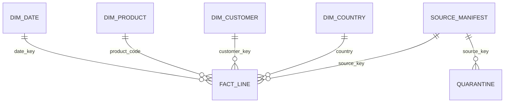

# Metric, schema and acceptance contract

Version 1.0 — 30 October 2026. This contract governs the implemented foundation, not an audited accounting system.

## Row grain and data flow

`fact_line` has one row per **declared source partition + worksheet row number or CSV record ordinal**. Invoice + product is deliberately not unique: legitimate repeated item lines are retained. Row identities start at two after the header; CSV ordinals count parsed records rather than physical lines, because quoted fields can span lines. A rerun replaces the complete declared partition in one transaction, including its manifest and quarantine. A source key must identify a stable scope; changing it creates a separate partition and can double-count overlapping data if a downstream query combines sources indiscriminately. All shipped controls filter to one source key.

The diagram's source-manifest relationships describe lineage; physical source-key foreign keys are not enforced because the manifest is written after validated facts in the same transaction. Fact-to-dimension foreign keys are enforced and checked before commit.

| Table / field | Contract |
|---|---|
| `source_manifest` | File SHA-256, declared scope, source/accepted/rejected row counts |
| `fact_line.source_key, source_row` | Composite primary key; source identity and physical row number |
| `invoice` | Source identifier normalized from integral spreadsheet values; cancellation prefix preserved |
| `product_code` | Source item identifier; numeric/string codes supported |
| `customer_key` | Source ID or explicit `UNKNOWN`; never an inferred identity |
| `date_key`, `timestamp_local` | Parsed naive source date/timestamp, no invented UTC conversion |
| `quantity` | Nonzero signed integer; negative values retained |
| `unit_value_units` | Nonnegative integer representing 1/10,000 GBP; more than four decimals rejected |
| `line_value_units` | Exact `quantity × unit_value_units`, guarded against signed 64-bit overflow |
| `is_cancellation` | Invoice identifier begins with `C`, case-insensitive; separate from quantity sign |
| `quarantine` | Source key, row number and rejection reason; raw rejected payload is not retained |
| `dim_date` | ISO date, calendar year/month/day |
| `dim_product` | Code and last-observed description, simple type-1 behavior |
| `dim_customer` | Key and unknown flag, with no name/contact data |
| `dim_country` | Stated source country label; not inferred nationality |

## Validation and quarantine policy

Reject missing invoice/product/country, malformed dates/numbers, timezone-aware dates outside this naive-time contract, nonfinite values, zero/fractional quantities, negative prices, excess price precision and numeric overflow. Zero prices are retained, not assumed to be errors. Missing customer IDs and descriptions are retained. A cancellation with positive quantity is preserved and flagged; the pipeline does not reverse its sign or invent a matching refund. A negative quantity without a `C` invoice remains negative.

Schema drift (including duplicate headers), duplicate source identity across either destination, invalid/nonpositive source ordinals, reader failure or aggregate overflow aborts the transaction and preserves the previous partition. Price scaling derives directly from the exact Decimal coefficient/exponent, without context-rounded arithmetic; trailing insignificant zeros are allowed, and very large values are bounded before integer expansion. Bad individual business rows are quarantined with reasons. These are different failure classes. Rejection does not imply the underlying source is fraudulent or wrong; it means the row cannot be represented under this explicit contract.

## KPI definitions and controls

| KPI | Definition | Interpretation limit |
|---|---|---|
| Source-row accounting | Inspected = accepted + quarantined | Only the declared source scope, not full-dataset completeness |
| Signed line value | Sum of signed quantity × stated unit price | Not recognized accounting revenue or profitability |
| Positive line value | Sum of line values strictly greater than zero | Zero-price rows remain accepted but contribute zero |
| Negative line value | Sum of line values strictly less than zero | Not automatically a matched refund or all cancellation activity |
| Known-customer share | Accepted lines with non-UNKNOWN ID / accepted lines | Coverage of lines, not percentage of unique real people |
| Cancellation-invoice lines | Accepted rows whose invoice begins with C | Independent of quantity sign |
| Monthly activity | Calendar month of original naive source date | Partial months must not be compared as complete periods |

Precommit checks require row accounting, foreign-key integrity, accepted counts and `signed = positive + negative`. Aggregate reports exclude customer-level rows. Price and value outputs retain four decimal places. A future presentation rounding policy must not silently replace source-control precision.

## Technical decisions

1. **SQLite before infrastructure:** deterministic local reproduction and transaction recovery can be reviewed without accounts or cloud cost. No claim of distributed scale is made.
2. **Integer fixed-point money:** avoid binary floating point; preserve up to four decimals rather than silently round sub-penny source prices. Aggregate overflow blocks publication.
3. **Source-row keys before deduplication:** no documented unique line key is available. Preserve evidence; investigate duplicate business semantics separately.
4. **Replacement before CDC:** bounded source snapshots are replaced atomically. Event-level updates/deletes, scheduling and concurrent writers are future requirements, not implemented behavior.
5. **Unknown-member customer:** retain complete all-line value accounting while making customer-analysis coverage visible.

Acceptance evidence is in [the executed validation record](../reports/VALIDATION.md). Costs, budgets, multi-currency conversion, causal retention, true customer lifetime value, supplier performance and ML are outside this data contract.
