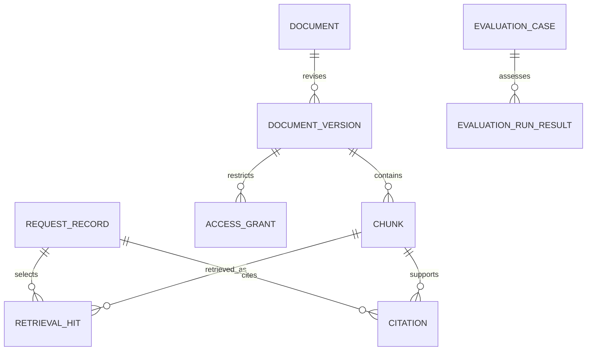

# Architecture and decisions

Design v1 · 30 October 2026 · proposed, not deployed.

## Data flow and boundaries

The ingestion worker resolves only allowlisted sources, extracts text and retains document/version/page/section provenance. It writes immutable source revisions and versioned chunks. Search applies caller authorization and document-validity rules **before** evidence reaches generation. An answer composer may generate only from permitted evidence; it returns supporting citations or an explicit refusal/abstention. An evaluation pipeline records retrieval and answer errors separately.

| Component | Responsibility |
|---|---|
| Corpus registry | Allowlist, rights, owner, version validity and source hash |
| Parser/chunker | Stable IDs, clean text, page/section references and transformation version |
| Retrieval adapters | Comparable lexical and embedding search with explicit model/index versions |
| Policy filter | Trusted caller scope, current/as-of validity and source authority |
| Evidence selector | Deduplicate chunks, bound context, detect insufficient/conflicting support |
| Answer composer | Optional generator with no permission to execute retrieved instructions |
| Citation resolver | Validate source/version/passage mapping and caller visibility |
| Evaluator | Frozen cases, retrieval labels, claim-level adjudication and error slices |

## Security and failure behavior

Retrieved documents are untrusted data. Their text cannot change access rules, tool permissions or the developer/system instructions. The first release has no external side-effecting tools. Synthetic access-control fixtures do not establish enterprise SSO security; actual authentication must be implemented and reviewed before a shared service is claimed.

The service derives caller identity and allowed groups from trusted middleware, never from caller-supplied JSON role names. Denied documents must be excluded from retrieval results, prompts, citations, error messages and logs. Re-check authorization during citation resolution. Global embedding caches must not disclose restricted text; cache scope and invalidation require tests.

Preserve all document revisions for reproducible evaluation, but use only versions valid for the request's supported date mode. If authoritative sources conflict, cite the conflict and abstain rather than invent a merged policy. Generation failure returns a clearly labeled evidence-only response or service error; it must not masquerade as a complete generated answer.

## Architectural decision records

| ADR | Proposed decision | Rationale / revisit condition |
|---|---|---|
| E-001 | Lexical retrieval baseline first | Establishes an inexpensive, reproducible comparison before adding embeddings |
| E-002 | Local model/runtime first | Avoids assuming new accounts or paid APIs; choose a model only after license/hardware checks |
| E-003 | Version and access filters before generation | Restricted or stale text must not enter a prompt and rely on the model to withhold it |
| E-004 | Stable citation IDs include source revision | Makes every answer traceable even after corpus updates |
| E-005 | Manual claim review supplements automated scoring | A fluent answer or an LLM judge alone does not prove factual support |
| E-006 | Generation and action automation are separate stages | A knowledge answer does not authorize an external action; approval-controlled drafting is a later extension |

## Resource and reliability plan

Begin with 20–50 licensed/authored documents and a bounded index. Pin parser, model and chunking versions, and record corpus hashes. Measure p50/p95 end-to-end and retrieval latency on named hardware with warm/cold conditions disclosed. Numerical targets are selected after baseline measurement and before final tuning. No availability, latency, accuracy or cost result currently exists.
