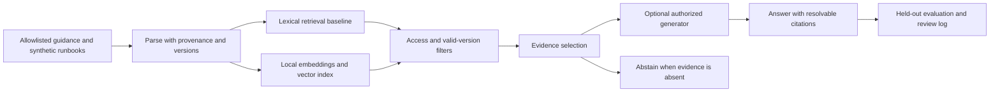

# Enterprise AI Knowledge Assistant

**Status: design specification complete · implementation not started · no runnable demo yet.**

A proposed service-operations assistant that answers from approved, versioned guidance, cites the supporting passage and declines questions that lack usable evidence. Its defining requirements are evidence quality, version validity and access boundaries.

## Business decision

A service operator needs to identify the approved steps for a release review without mixing current guidance, superseded documents and unapproved notes. A knowledge owner needs to inspect why an answer was produced and correct the source rather than edit a hidden prompt. These are proposed stakeholders and workflows, not claims of customers or measured time savings.

## Proposed delivery

| Capability | Planned implementation |
|---|---|
| Ingestion | Allowlisted HTML and authored text-based PDF fixtures; document/page/section metadata |
| Search | Lexical baseline, then locally runnable embeddings with PostgreSQL/pgvector |
| Answering | Optional local or already-authorized generator; evidence-grounded response or abstention |
| Interface | FastAPI request/response contract with caller identity supplied by trusted authentication |
| Evaluation | Frozen held-out questions, retrieval metrics, manual citation/claim review and adversarial access/version tests |
| Automation extension | Draft-only workflow with explicit approval, idempotency and audit records; outside core release |

No embedding model, LLM, vector database, API service or hosted demo has been executed for this project. A lexical baseline will not be presented as semantic embeddings or a functioning generative model. OCR, model fine-tuning, autonomous tool execution and paid cloud services are outside the first scope.

## Corpus and rights

Use a bounded, versioned subset of the [GOV.UK Service Manual](https://www.gov.uk/service-manual), including [service measurement guidance](https://www.gov.uk/service-manual/measuring-success), plus original **synthetic** internal runbooks and PDF fixtures. [GOV.UK terms](https://www.gov.uk/help/terms-conditions) describe OGL reuse conditions and exceptions. Record attribution and confirm each selected page's rights before copying; third-party exclusions must be respected.

No real employer documents, employee data or confidential files are required. “Internal” policy examples will be clearly authored scenarios, not claims about a real company's rules. Model weights also need a reviewed model card/license, version, size and hardware fit before selection.

## Evidence expected from the eventual demo

- A question resolves to the applicable source version and supporting section/page.
- An unanswerable or conflicting-policy question produces an explicit abstention.
- A synthetic restricted document never appears in an unauthorized answer, citation or log.
- A retrieval failure is reported separately from a generation failure.
- Retrieval quality, citation correctness and latency are measured on a declared test set, without converting them into invented business savings.

Read the [architecture and decisions](ARCHITECTURE.md), [corpus/API contracts](CONTRACTS.md) and [requirements with evaluation plan](ACCEPTANCE.md). Installation and demo commands will be added after working implementation exists.

**Roles supported after implementation:** Generative AI Associate, Junior Python Developer–AI/Data and Junior NLP/LLM Engineer; an evaluated training/fine-tuning component is still needed for roles that require model training. AI Automation Engineer evidence requires its separately tested approval-controlled extension.
