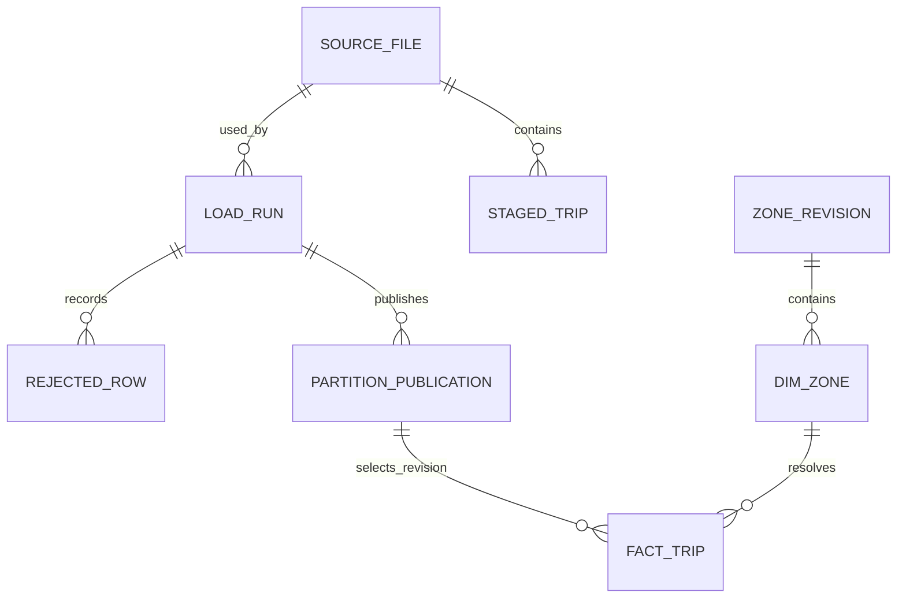

# Architecture and decisions

Design v1 · 30 October 2026 · proposed, not deployed.

## Components and trust boundaries

The downloader accepts only approved public source URLs and explicit partitions. A manifest identifies immutable inputs. Validation builds a typed staging relation and a reason-coded rejection relation. Publication updates the warehouse and successful-run metadata in one transaction. dbt owns analytical transformations; the orchestrator invokes the same partition operation used locally.

| Relation | Grain / identity | Purpose |
|---|---|---|
| `source_file` | One dataset/partition/content SHA-256 | URL, bytes, retrieval time and source schema |
| `load_run` | One attempt UUID | Contract/code version, timings, row controls and terminal outcome |
| `staged_trip` | One source hash + row ordinal | Deterministic row identity; no invented natural trip key |
| `rejected_row` | One attempt + source-row identity | Validation reasons and safe diagnostic fields |
| `partition_publication` | One publication revision | Active partition pointer, source revision and successful run |
| `dim_zone` | One zone ID per lookup revision | Zone/borough reference and unknown-zone member |
| `fact_trip` | One accepted source row in a published revision | Typed trip facts and lineage |
| `mart_trip_zone_day` | One service date + pickup zone + publication revision | Count/amount aggregates, coverage and quality context |

This schema is a design contract, not a migration already applied. Separate reference-data revisions prevent a later zone lookup from silently rewriting old results.

## Publication and recovery

Proposed run states are `discovered → downloaded → validated → staged → published`; failures retain an explicit failed stage and cause. Only `published` is a successful data delivery. A partition lock prevents concurrent writers from publishing conflicting revisions.

Load into isolated staging first. In one PostgreSQL transaction, verify controls, replace the selected partition's active facts or revision pointer, and write its publication metadata. Inject a failure before commit to prove the old published revision remains usable. Successful retries with the same source hash and contract version become no-ops; changed checksums create auditable source revisions. A changed transformation contract is a deliberate reprocessing operation even when source bytes are unchanged.

Do not advance an ingestion watermark simply because a file downloaded. Do not deduplicate trips using guessed combinations of timestamp, zone and amount. Duplicate-looking source rows remain distinct unless a separately approved source rule establishes otherwise.

## Operational visibility

Record partition, source/version, run ID, code revision, contract version, stage, accepted/rejected/input counts, duration and error category. Logs exclude tokens and unnecessary row contents. A status report distinguishes an unpublished source month, download failure, validation failure and failed warehouse publication.

Source timestamps must be profiled before timezone normalization. Preserve their original interpretation; do not silently assign UTC to unqualified local timestamps. Document treatment of DST ambiguity and invalid durations in the approved contract.

## Architectural decision records

| ADR | Proposed decision | Rationale / revisit condition |
|---|---|---|
| B-001 | Local PostgreSQL + Parquet first | Enough to prove transactional publication and lineage without paid infrastructure; revisit scale only after resource measurements |
| B-002 | File hash + row ordinal for source identity | The selected source does not guarantee a natural trip ID; revision-aware row identity avoids incorrect business deduplication |
| B-003 | Deterministic CLI before Airflow | The scheduler should reuse a tested partition operation; retries must be safe independently of orchestration |
| B-004 | dbt owns marts, Python owns ingestion | Keeps transformation lineage and loading/recovery responsibilities explicit |
| B-005 | No lakehouse label in the first release | Bronze/silver/gold naming alone does not implement transactional table-format capabilities |

[Airflow's best-practice guidance](https://airflow.apache.org/docs/apache-airflow/stable/best-practices.html) supports partition-specific, repeatable tasks. Applying that guidance and measuring reliability are future implementation work.
