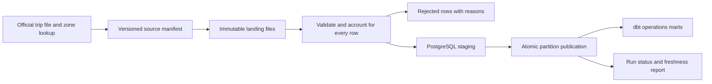

# Data Pipeline Reliability & Monitoring Platform

**Status: design specification complete · implementation not started · no runnable demo yet.**

A proposed analytics data service that publishes transport operations marts only after reconciliation, while making source revisions, failed loads and recovery visible. The engineering question is whether the same monthly partition can be replayed safely without corrupting the last trusted result.

## Business decision

An analytics lead needs to know which reporting periods are trustworthy, why a refresh failed, and whether a correction has reached downstream reports. A data engineer needs a bounded backfill operation and enough lineage to reproduce a published number. These are proposed stakeholder needs, not claims of interviews or production customers.

The first delivery uses one fixed historical NYC taxi month and a zone lookup. It demonstrates a dependable warehouse workflow rather than a large collection of cloud services.

## Scope and proposed stack

| Responsibility | Planned implementation |
|---|---|
| Ingestion | Python downloader, manifest, explicit partition CLI and bounded retries |
| Storage | Local immutable Parquet landing files and PostgreSQL warehouse |
| Modeling | dbt staging and trip-by-zone/day marts with declared grain |
| Scheduling | Airflow only after the command-line pipeline passes recovery tests |
| Demonstration | Docker Compose, authored synthetic failure fixtures and an operational report |
| Quality | Row accounting, checksums, schema compatibility, key relationships and metric reconciliation |

This is a **layered warehouse design**. A transactional lakehouse/table format, Spark cluster and cloud deployment are outside the first release. No software stack has been installed or benchmarked for this project.

## Data and rights

The [official NYC TLC page](https://www.nyc.gov/site/tlc/about/tlc-trip-record-data.page) provides monthly trip Parquet files and taxi-zone reference data, with accuracy/completeness caveats and schema notices. Choose an exact historical file during implementation and record its URL, retrieval time, content hash, schema and row count. Do not treat source publication lag as an internal pipeline failure.

Record the applicable [NYC terms](https://www.nyc.gov/main/terms-of-use) and [Open Data terms](https://data.cityofnewyork.us/stories/s/Terms-of-Use/k9k7-3cje/) before acquisition/redistribution. No raw dataset is included here, and no blanket CC BY/public-domain claim is made. Public demos will use aggregates and authored synthetic fixtures; no passenger identification or cross-source identity linkage is planned.

## Decisions the demonstration should answer

- Is each requested partition available, validated and published?
- Did a source correction change the file or the resulting mart?
- Does a failed replacement leave the previous trusted partition intact?
- Can another engineer reproduce a run from its source and contract versions?

Operational measures are source lag, internal processing lag, accepted/rejected share, unknown-zone rate, partition state and measured run time. They are not claims of improved transport profitability or saved engineering hours.

## Delivery sequence

1. Resolve source terms; download/profile one bounded month; approve schema and timezone assumptions.
2. Implement manifest, validator, transactional loader and replay/recovery fixtures.
3. Add dbt marts, data tests and source-to-mart controls.
4. Add status reporting and Docker reproduction; measure resources on named hardware.
5. Introduce partition-specific Airflow orchestration only after CLI reliability passes.

Read the [architecture and decisions](ARCHITECTURE.md), [data/operation contracts](CONTRACTS.md) and [requirements with release tests](ACCEPTANCE.md). There are no installation or demo commands yet because executable implementation does not exist.

**Roles supported after implementation:** Associate/Junior Data Engineer, Junior Analytics Engineer and Junior Python Developer–Data. Design documentation alone does not establish production experience.
